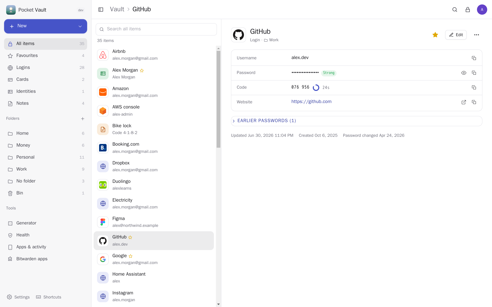
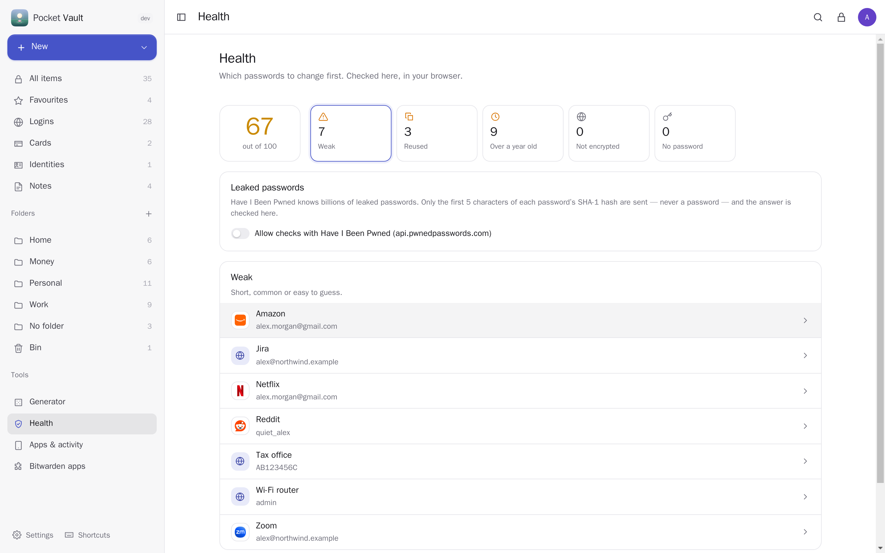
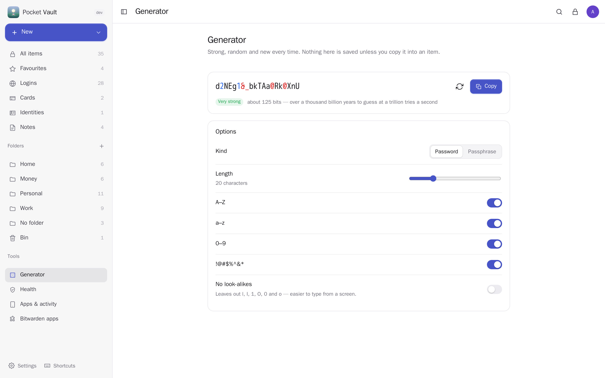
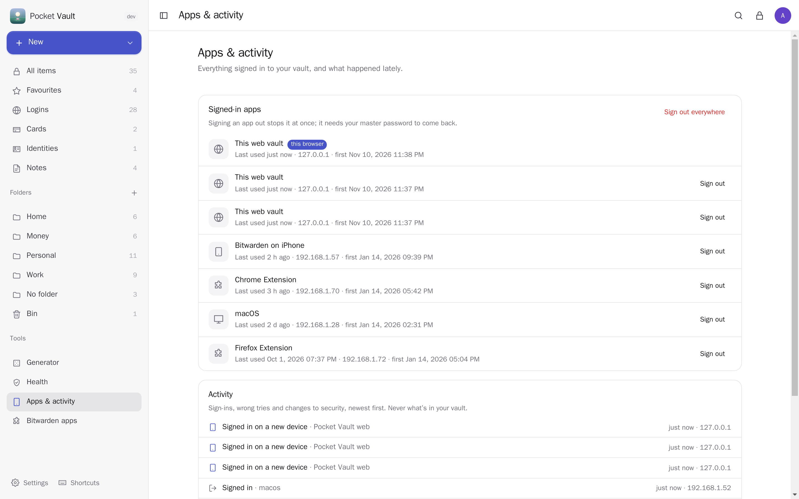
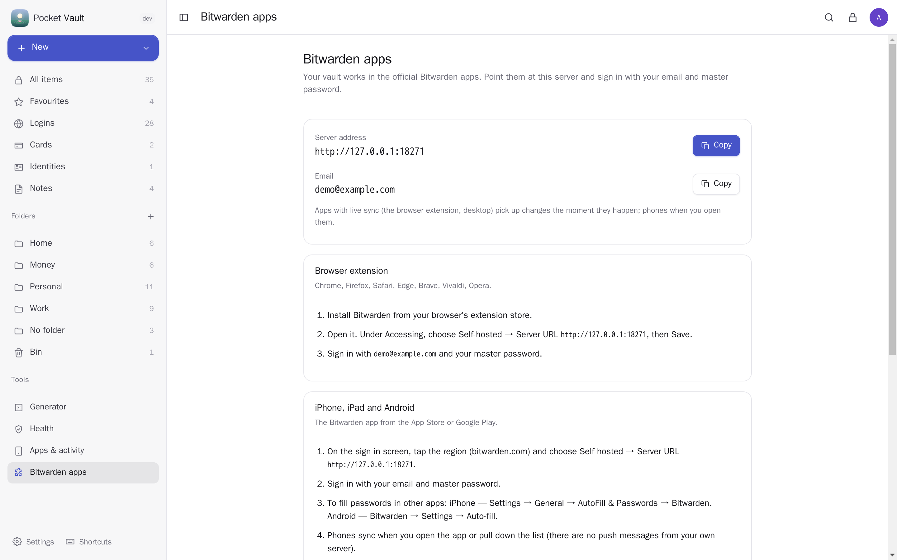
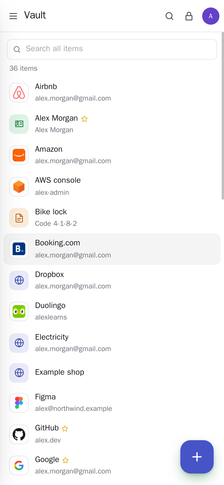
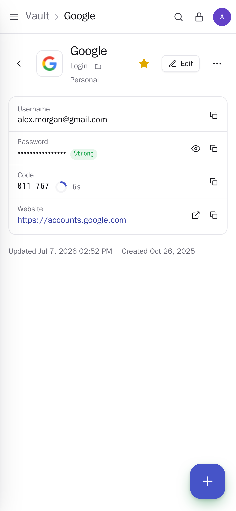

<p align="center"></p>
<h1 align="center">Pocket Vault</h1>
<p align="center">Your passwords, cards, notes and identities on your own server, in the official Bitwarden apps. Point the browser extension, the iPhone and Android apps, the desktop app or the <code>bw</code> CLI at it and sign in: it speaks the same API as bitwarden.com and Vaultwarden, field for field, with live sync. Everything is encrypted on your devices; the server never sees a password. It has its own web vault too — a quick list with live authenticator codes, a password and passphrase generator, a health check for weak, reused, old and leaked passwords, two-step login, every signed-in app with its activity — and it moves a whole Vaultwarden server over in one step, with the apps staying signed in.<br>One Go binary, one SQLite file, one volume. Part of the Pocket apps; works on its own too.</p>
<p align="center">
  <a href="https://github.com/abjelosevic88/pocket-homelab-vault/actions"></a>
  <a href="https://github.com/abjelosevic88/pocket-homelab-vault/pkgs/container/pocket-homelab-vault"></a>
  <a href="LICENSE"></a>
</p>

---

<p align="center"></p>

<table>
  <tr>
    <td width="50%"></td>
    <td width="50%"></td>
  </tr>
  <tr>
    <td align="center"><sub>Health: which passwords to change first, worked out in your browser. Leak checks send only five characters of a hash.</sub></td>
    <td align="center"><sub>Passwords and passphrases (EFF word list), with how long they'd take to guess.</sub></td>
  </tr>
  <tr>
    <td width="50%"></td>
    <td width="50%"></td>
  </tr>
  <tr>
    <td align="center"><sub>Every app signed in to your vault; sign one out, or all of them. Sign-ins and wrong tries, newest first.</sub></td>
    <td align="center"><sub>One address for the extension, the phones, the desktop and the CLI.</sub></td>
  </tr>
  <tr>
    <td width="50%"></td>
    <td width="50%"></td>
  </tr>
</table>

## What it does

- **Works with the Bitwarden apps.** Browser extension (Chrome, Firefox, Safari, Edge…), iPhone, iPad, Android, desktop and `bw`: choose *Self-hosted*, enter the address, sign in. Logins with passkeys, cards, identities, notes and SSH keys, folders, favourites, the bin, archive, password history, custom fields, master password re-prompt, per-item keys, domain rules, website icons and live sync over websockets (the extension updates the moment you change something on your phone).
- **Zero knowledge.** The apps — and this app's own web vault — encrypt on the device with a key made from your master password (PBKDF2 or Argon2id). The server keeps encrypted text it can't read; an admin can't open anyone's vault, and neither can a stolen backup.
- **A web vault of its own**, in the Pocket style: search, filters and folders, live authenticator codes, copy buttons that clear the clipboard after a while, an edit form with the generator built in, keyboard shortcuts (`/` find, `n` new, `p` copy the password, `l` lock), auto-lock, light and dark.
- **Health**: a score and the lists — leaked (Have I Been Pwned, k-anonymity), weak, reused, over a year old, sent over plain http, no password.
- **Passkeys**: unlock with Touch ID, Face ID, Windows Hello, your phone or a security key instead of typing the master password, and sign in to Pocket Vault with one tap (signed in and unlocked). Uses the WebAuthn PRF extension the way Bitwarden's "log in with passkey" does: the passkey makes a secret only it can make again, which opens your key in the browser; the server keeps only wrapped keys and can't read anything. Passkeys whose browser or key lacks PRF still sign in, then ask for the master password. Up to 10 per vault; adding or removing one asks for the master password.
- **Security**: two-step login with an authenticator app (QR code, recovery code, "remember this browser"), changing the master password (every app signs out), sign-in limits, signed-in apps with their last use, sign out one or all, and an activity list. Notifications for new devices, wrong tries and security changes, through Pocket Alerts, Apprise, ntfy or a webhook.
- **Moves over from Vaultwarden**: `pocket-vault import-vaultwarden -dir /path/to/vw-data` (or an upload in Settings) copies every account with its master password check, items, folders, favourites, archive, bin, signed-in apps and authenticator. With Vaultwarden's `rsa_key.pem` the apps stay signed in once the address points here. Import from Bitwarden JSON/CSV and browsers' CSV exports; export Bitwarden's encrypted or readable JSON.
- **Everyone their own.** Each person on the box has their own vault and master password.

Not there yet: sharing (organisations), attachments, Send, emergency access. Imports leave those in Vaultwarden and say so.

## Run it

```sh
docker run -d --name pocket-vault -p 8080:8080 -v ./data:/data \
  -e BASE_URL=https://vault.example.com -e SECURE_COOKIES=true \
  ghcr.io/abjelosevic88/pocket-homelab-vault:latest
```

or `docker compose up -d` with [docker-compose.yml](docker-compose.yml). The Bitwarden apps need HTTPS: put it behind a reverse proxy ([docs/reverse-proxy.md](docs/reverse-proxy.md)). Open it, create the first account, set up your vault, then follow *Bitwarden apps* in the sidebar. All options: [docs/configuration.md](docs/configuration.md). API: [docs/api.md](docs/api.md). Backups: [docs/backup.md](docs/backup.md).

Coming from Vaultwarden: stop it, run `pocket-vault import-vaultwarden -dir <its data folder>` (with Pocket Vault stopped), give Pocket Vault Vaultwarden's address and start it.

## With Pocket Core

Set `CORE_URL` and `CORE_REGISTRATION_KEY` and Vault joins the box: people sign in to the web app with Pocket Core (the vault still needs their master password). On a card, *Remind me before it expires* puts the date into Pocket Renewals — only the title, the cardholder, the date and the last four digits. Other Pocket apps may read `vault:read`: how many items, which apps are signed in, whether two-step login is on, recent sign-ins, and the health numbers if the person shares them (counts only). Events on the bus: `vault.created`, `vault.device_signed_in`, `vault.signin_failed`, `vault.security_changed`. There is deliberately no Pocket AI inside the vault. Without Core the Renewals link can be made directly with a URL and a token; the Core-only choices stay visible, greyed out.

## Develop

```sh
make dev     # API on :8080 with a demo vault (master password: correct horse battery staple) + Vite on :5173
make test    # go vet, go test, tsc
node scripts/bw-compat.mjs   # the newest official Bitwarden CLI against a demo vault (see the file; weekly in CI)
make         # web + binary
```

MIT licensed. Not affiliated with Bitwarden, Inc. Like Vaultwarden, it implements the API their open-source apps use. Passphrases use the EFF large wordlist (CC BY 3.0).
